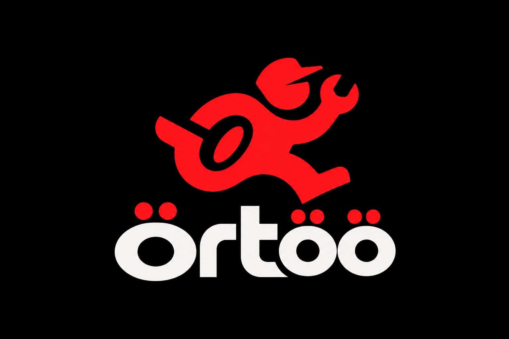
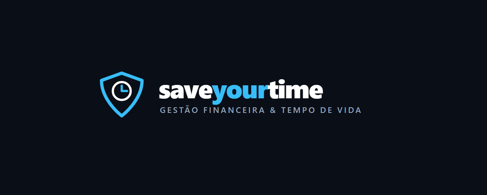

# 🚀 Projeto de Sistemas — 2026/2

### Universidade Federal do Tocantins (UFT) · Câmpus de Palmas
### Bacharelado em Ciência da Computação

---

## 🧭 Sumário

| # | Seção |
|---|---|
| 1️⃣ | [Sobre a Disciplina](#1--sobre-a-disciplina) |
| 2️⃣ | [Professor Responsável](#2--professor-responsável) |
| 3️⃣ | [Notícias e Reconhecimentos](#3--notícias-e-reconhecimentos) |
| 4️⃣ | [Participação em Competições e Eventos](#4--participação-em-competições-e-eventos) |
| 5️⃣ | [Mentorias e Apresentação de Pitch](#5--mentorias-e-apresentação-de-pitch) |
| 6️⃣ | [Projeto de Sistemas](#6--projeto-de-sistemas) |
| 7️⃣ | [Projetos Desenvolvidos](#7--projetos-desenvolvidos) |
| ↳ | [Grupo 1 — ÖRTÖÖ Assistência Veicular](#71--grupo-1-örtöö-assistência-veicular) |
| ↳ | [Grupo 2 — Obra Circular](#72--grupo-2-obra-circular) |
| ↳ | [Grupo 3 — Projeto a definir](#73--grupo-3-projeto-a-definir) |
| ↳ | [Grupo 4 — SaveYourTime](#74--grupo-4-saveyourtime) |
| ↳ | [Grupo 5 — Projeto a definir](#75--grupo-5-projeto-a-definir) |
| ↳ | [Grupo 6 — Projeto a definir](#76--grupo-6-projeto-a-definir) |
| ↳ | [Grupo 7 — Projeto a definir](#76--grupo-6-projeto-a-definir) |
| 8️⃣ | [Parceiros e Apoio Institucional](#8--parceiros-e-apoio-institucional) |
| 9️⃣ | [Registros e Fotografias](#9--registros-e-fotografias) |
| 🔟 | [Relatos dos Alunos](#10--relatos-dos-alunos) |
| 1️⃣1️⃣ | [Documentos Importantes](#11--documentos-importantes) |

---

## 1. 📘 Sobre a Disciplina

A disciplina **Projeto de Sistemas** integra a formação dos estudantes do curso de Bacharelado em Ciência da Computação da Universidade Federal do Tocantins (UFT), Câmpus de Palmas.

A proposta é proporcionar uma experiência prática de concepção, planejamento, desenvolvimento e validação de sistemas, incentivando os estudantes a identificar problemas, compreender as necessidades dos usuários e elaborar soluções tecnológicas com potencial de aplicação real.

Durante o semestre, os grupos trabalham na construção de projetos que envolvem aspectos técnicos do desenvolvimento de software, inovação, organização de equipes e viabilidade das soluções propostas.

Entre as atividades desenvolvidas, destacam-se a identificação de problemas, o levantamento de requisitos, a definição de funcionalidades, a prototipação, a implementação, os testes, a documentação e a apresentação dos resultados.

A disciplina também incentiva competências relacionadas à comunicação, ao trabalho em equipe, à criatividade, à liderança e à resolução de problemas, aproximando a formação acadêmica das práticas profissionais.

### 🎯 Objetivos

- Aplicar os conhecimentos adquiridos ao longo do curso no desenvolvimento de sistemas.
- Identificar problemas e propor soluções tecnológicas relevantes.
- Desenvolver habilidades de planejamento, organização e gestão de projetos.
- Estimular a colaboração e a divisão de responsabilidades entre os integrantes.
- Praticar a documentação, a apresentação e a validação das soluções desenvolvidas.
- Incentivar a inovação e o contato com demandas reais da sociedade e do mercado.

---

## 2. 👤 Professor Responsável

### Edeilson Milhomem da Silva

O professor Edeilson Milhomem da Silva é doutor em Ciência da Computação e docente do curso de Bacharelado em Ciência da Computação da UFT.

Atua na promoção de iniciativas que aproximam a academia do mercado, com foco em inovação, empreendedorismo tecnológico e engenharia de software.

Em 2026, recebeu do SEBRAE o prêmio **Professor Empreendedor**. É coautor do livro *Sistemas Colaborativos*, obra reconhecida nacionalmente na área e premiada com o terceiro lugar no Prêmio Jabuti 2012, na categoria Tecnologia e Informática.

Também é cofundador do Movimento Startup Tocantins, iniciativa voltada ao fortalecimento do ecossistema de inovação e empreendedorismo no estado do Tocantins.

Coordena o Laboratório EPIC de Aprendizagem Colaborativa, espaço dedicado à inovação, às metodologias ativas e ao desenvolvimento de competências empreendedoras. No EPIC, lidera projetos voltados à criação de soluções tecnológicas alinhadas às demandas reais da sociedade e do setor produtivo.

---

## 3. 📰 Notícias e Reconhecimentos

Espaço destinado à divulgação de notícias, publicações institucionais, eventos acadêmicos, reconhecimentos e outras iniciativas relacionadas à disciplina e aos projetos desenvolvidos.

### 📣 Notícia ou publicação institucional

| Informação | Conteúdo |
|---|---|
| **Título** | Título da notícia |
| **Data** | Data da publicação |
| **Fonte** | Nome do portal ou instituição |
| **Descrição** | Resumo da publicação |
| **Link** | [Acessar notícia](#) |

### 🎬 Divulgação nas redes sociais

**Descrição:** insira um resumo da publicação, campanha ou vídeo relacionado à disciplina.

**🔗 Link:** [Acessar publicação](#)

---

## 4. 🏆 Participação em Competições e Eventos

Esta seção reúne informações sobre a participação dos projetos em competições, feiras, eventos acadêmicos, demonstrações públicas e iniciativas de inovação e empreendedorismo.

### 📅 Participação em eventos

- **Evento:** nome do evento.
- **Data:** data de realização.
- **Local:** local do evento.
- **Projetos participantes:** identificação dos grupos envolvidos.
- **Descrição:** resumo da participação e dos resultados alcançados.

### 🥇 Premiações e reconhecimentos

| Colocação ou reconhecimento | Projeto | Evento |
|---|---|---|
| A definir | Nome do projeto | Nome do evento |
| A definir | Nome do projeto | Nome do evento |
| A definir | Nome do projeto | Nome do evento |

*Preencha esta tabela somente quando houver resultados confirmados.*

---

## 5. 🎤 Mentorias e Apresentação de Pitch

Ao longo da disciplina, esta seção documentará atividades de mentoria, apresentações de propostas, sessões de feedback e treinamentos destinados ao aprimoramento dos projetos.

Essas atividades contribuem para o desenvolvimento da capacidade de comunicação dos estudantes, permitindo que apresentem suas soluções, expliquem os problemas identificados, demonstrem os benefícios das propostas e recebam sugestões de melhoria.

### 📸 Registros das atividades

**Descrição da atividade:** insira informações sobre a atividade realizada, seus objetivos, os participantes e os principais aprendizados.

---

## 6. 💡 Projeto de Sistemas

A disciplina propõe o desenvolvimento de projetos que integrem conhecimentos técnicos, planejamento e compreensão das necessidades dos usuários.

Cada grupo deverá apresentar sua solução, descrevendo o problema que pretende resolver, o público-alvo, os objetivos do sistema, suas principais funcionalidades e as tecnologias utilizadas.

Os projetos também poderão ser apresentados por meio de demonstrações, vídeos, protótipos, apresentações técnicas e outros materiais que permitam compreender o processo de desenvolvimento e os resultados alcançados.

### 📌 Etapas do desenvolvimento

1. Identificação do problema e definição da proposta.
2. Levantamento e análise de requisitos.
3. Planejamento e organização das atividades.
4. Modelagem e prototipação da solução.
5. Implementação e integração dos componentes.
6. Testes, validação e melhorias.
7. Documentação e apresentação final.

---

## 7. 🛠 Projetos Desenvolvidos

Esta seção apresenta os projetos desenvolvidos pelos grupos durante a disciplina **Projeto de Sistemas — 2026/1**.

Cada projeto contém uma descrição da solução, suas principais funcionalidades, as tecnologias utilizadas, os integrantes da equipe e os links para o repositório, a demonstração e a documentação produzida.

---

### 7.1. 🚀 Grupo 1 — ÖRTÖÖ Assistência Veicular

**ÖRTÖÖ Assistência Veicular**

#### 📝 Sobre o projeto

O **ÖRTÖÖ** é uma plataforma de assistência veicular sob demanda que conecta, por meio da geolocalização, pessoas que enfrentam imprevistos durante seus trajetos a prestadores de serviços próximos.

#### 🧭 Da solicitação ao atendimento

| Etapa | O que o sistema oferece |
|---|---|
| **01 · Criar uma conta** | Cadastro, autenticação via JWT e gerenciamento de perfis (Motorista/Cliente e Mecânico/Prestador), com validação de documentos (CPF/CNPJ). |
| **02 · Oferta de serviços** | Gerenciamento de serviços e categorias prestadas (guincho, mecânica, troca de pneu etc.), com definição de valores e raio de atendimento em km. |
| **03 · Localização e chamada** | Monitoramento via GPS em tempo real, busca de prestadores por categoria no mapa e criação de solicitações de socorro com coordenadas de origem. |
| **04 · Pagamento e aceite** | Checkout integrado com suporte a PIX, cartão (Stripe) e dinheiro; liberação de aceite de chamados e canal de chat direto entre cliente e mecânico. |
| **05 · Acompanhamento em tempo real** | Linha do tempo do status do atendimento (*Pendente*, *Aceito*, *A caminho*, *Em atendimento*, *Concluído*), com rastreamento do mecânico no mapa até a finalização. |

**Gestão da plataforma:** painel e APIs para controle de solicitações, conciliação de transações e atualização de disponibilidades dos prestadores em tempo real.

#### 🛠️ Tecnologias

| Camada | Tecnologias utilizadas |
|---|---|
| **Interface (Mobile)** | `React Native` · `Expo` · `Expo Router` · `TypeScript` · `React Native Maps` |
| **API Backend** | `Node.js` · `Express` · `JWT` · `REST API` |
| **Banco de dados** | `MySQL` |
| **Pagamentos** | `Stripe API` (cartões) · `PIX / Dinheiro` |
| **Serviços e Geolocalização** | `Expo Location` · `Fetch API` |

#### 👥 Integrantes

| Integrante | GitHub |
|---|---|
| **Vinicius Silveira** | [@viniciussdudu](https://github.com/viniciussdudu) |
| **Klaus Henrique** | [@Klaus1215](https://github.com/Klaus1215) |
| **Daniel Vinicius** | [@DrEggman00](https://github.com/DrEggman00) |
| **Arthur Bispo** | [@bispo047](https://github.com/bispo047) |
| **Thiago Soares** | [@Soares314](https://github.com/Soares314) |
| **Samara Coelho** | [@SamaraCdS-UFT](https://github.com/SamaraCdS-UFT) |

#### 📦 Repositório e documentação

| Recurso | Link |
|---|---|
| **Código-fonte** | [Repositório oficial](https://github.com/viniciussdudu/Ortoo-Assistencia-veicular) |
| **Executar o projeto** | [Acessar repositório](https://github.com/viniciussdudu/Ortoo-Assistencia-veicular) |
| **Documentação técnica** | [Acessar repositório](https://github.com/viniciussdudu/Ortoo-Assistencia-veicular) |
| **Landing page** | Link a disponibilizar |

#### 📸 Registro da equipe

*Adicione aqui a fotografia da equipe ÖRTÖÖ.*

---

### 7.2. ♻️ Grupo 2 — Obra Circular

**Obra Circular**  
*Construir também é reaproveitar.*

#### 📝 Sobre o projeto

O **Obra Circular** é um marketplace de compra e venda de materiais de construção. Conecta quem tem materiais e sobras de obras a quem precisa deles para construir ou reformar, incentivando o reaproveitamento e o acesso a preços mais acessíveis.

A plataforma atende pessoas em obras ou reformas, profissionais e empresas da construção civil, reunindo anúncios, compras e acompanhamento de pedidos em um só lugar.

> **Nosso propósito:** manter materiais em circulação, reduzir o desperdício e estimular a economia circular na construção.

#### 🧭 Da publicação à entrega

| Etapa | O que o sistema oferece |
|---|---|
| **01 · Criar uma conta** | Cadastro, autenticação e gerenciamento de perfil e endereços. |
| **02 · Anunciar materiais** | Publicação e gestão de anúncios com fotos, categorias, preços e quantidades disponíveis. |
| **03 · Encontrar o que precisa** | Busca com filtros, detalhes dos materiais e perguntas e respostas com vendedores. |
| **04 · Comprar e acompanhar** | Pagamento com Mercado Pago e acompanhamento de compras, pedidos e vendas. |
| **05 · Confirmar a entrega** | Confirmação de entrega ou retirada por PIN e abertura e acompanhamento de contestações. |

**Gestão da plataforma:** painel administrativo para gerenciar usuários, anúncios e categorias.

#### 🛠️ Tecnologias

| Camada | Tecnologias utilizadas |
|---|---|
| **Interface** | `React 19` · `TypeScript` · `Vite` · `React Router` |
| **API** | `Python` · `FastAPI` · `SQLAlchemy assíncrono` · `Pydantic` · `Alembic` |
| **Banco de dados** | `PostgreSQL` |
| **Pagamentos** | `Mercado Pago Checkout Pro` |
| **Qualidade e testes** | `Pytest` · `Ruff` · `mypy` · `Vitest` · `Testing Library` · `Oxlint` |

#### 👥 Integrantes

| Integrante | GitHub |
|---|---|
| **José Guilherme Ferreira** | [@joseguifs](https://github.com/joseguifs) |
| **Breno Borges** | [@Brenoborgesbr](https://github.com/Brenoborgesbr) |
| **Mario Felipe** | [@Mario-FelipeBN](https://github.com/Mario-FelipeBN) |
| **Matheus Felipe** | [@MatheusF-del](https://github.com/MatheusF-del) |

#### 📦 Repositório e documentação

| Recurso | Link |
|---|---|
| **Código-fonte** | [Repositório oficial](https://github.com/joseguifs/obraCircular) |
| **Configuração e execução** | [Guia de instalação](https://github.com/joseguifs/obraCircular#primeira-configuração) |
| **Backend** | [Documentação da API](https://github.com/joseguifs/obraCircular/blob/HEAD/backend/README.md) |
| **Frontend** | [Documentação da interface](https://github.com/joseguifs/obraCircular/blob/HEAD/frontend/README.md) |
| **Landing page** | Link a disponibilizar |

#### 📸 Registro da equipe

*Adicione aqui a fotografia da equipe Obra Circular.*

---

### 7.3. 🚀 Grupo 3 — Projeto a definir

#### 📝 Sobre o projeto

Apresente o sistema, seu propósito, o problema que busca resolver e o público-alvo.

#### 🎯 Objetivos e funcionalidades

- Funcionalidade principal do sistema.
- Funcionalidade secundária.
- Recursos adicionais oferecidos aos usuários.

#### 🛠️ Tecnologias utilizadas

`Tecnologia 1` · `Tecnologia 2` · `Tecnologia 3`

#### 👥 Integrantes

| Integrante | GitHub |
|---|---|
| Nome do integrante 1 | [@usuario](#) |
| Nome do integrante 2 | [@usuario](#) |
| Nome do integrante 3 | [@usuario](#) |
| Nome do integrante 4 | [@usuario](#) |

#### 📦 Repositório e documentação

| Recurso | Link |
|---|---|
| **Repositório oficial** | A disponibilizar |
| **Landing page / Sistema** | A disponibilizar |
| **Vídeo demonstrativo** | A disponibilizar |
| **Apresentação final** | A disponibilizar |
| **Documentação técnica** | A disponibilizar |

#### 📸 Registro da equipe

*Adicione aqui a fotografia da equipe.*

---

### 7.4. ⏳ Grupo 4 — SaveYourTime

**SaveYourTime**  
*Transformando preços em tempo de vida.*

#### 📝 Sobre o projeto

O **SaveYourTime** é um aplicativo mobile voltado para gestão financeira comportamental e consumo consciente. Em vez de se limitar a planilhas tradicionais de receitas e despesas, o sistema traduz o valor monetário de produtos e desejos de compra em **horas de trabalho (horas de suor)** necessárias para quitá-los, conscientizando o usuário sobre o impacto real de cada gasto na sua vida e no seu tempo livre.

A plataforma atua na prevenção de compras por impulso, no combate ao desperdício financeiro e no planejamento de longo prazo, reunindo inteligência comportamental, quarentena reflexiva de gastos e acompanhamento de metas em um só lugar.

> **Nosso propósito:** transformar preços em tempo de vida e ajudar pessoas a conquistarem liberdade financeira por meio do consumo consciente.

#### 🧭 Funcionalidades

| Módulo | O que o sistema oferece |
|---|---|
| **01 · Conversor de Horas de Suor** | Converte o valor de produtos em horas úteis de trabalho e calcula o *Financial Health Score* do usuário. |
| **02 · Quarentena e Cooldown (48h / 7d)** | Período de reflexão para desejos imediatos, com quiz de autocontrole para evitar compras por impulso. |
| **03 · Detox de Assinaturas** | Rastreamento de mensalidades recorrentes, custo real por uso e detecção de serviços concorrentes ou redundantes. |
| **04 · 3 Potes (Regra 50-30-20)** | Divisão orçamentária entre necessidades básicas (50%), estilo de vida (30%) e reserva/dívidas (20%). |
| **05 · Radar de Ofertas e Histórico** | Comparador de preços, monitoramento do menor preço histórico e alertas de oportunidade. |
| **06 · Metas de Liberdade Financeira** | Projeção de patrimônio em "dias de liberdade" e cálculo de aceleração por economia. |

#### 🛠️ Tecnologias

| Camada | Tecnologias utilizadas |
|---|---|
| **Mobile / Frontend** | `React Native` · `Expo SDK 52` · `JavaScript` · `StyleSheet (CSS-in-JS)` |
| **API / Backend** | `Node.js` · `Express` · `Arquitetura MVC` · `REST API` |
| **Controle de versão e gestão** | `Git` · `GitHub` · `Metodologia Ágil (Sprints)` |

#### 👥 Integrantes

| Integrante | GitHub |
|---|---|
| **Vitória Maria Reis Fontana** | [@vitoriamrfontana](https://github.com/vitoriamrfontana) |
| **Arthur Vinicius de Oliveira Carvalho** | [@arthur8409](https://github.com/arthur8409) |
| **Murillo Fernandes de Oliveira** | [@murillofnandes](https://github.com/murillofnandes) |
| **Tiago Veras Ferreira** | [@tiagoverasf](https://github.com/tiagoverasf) |
| **Afonso Dglan Cirqueira Rodrigues** | [@AfonsoDglan](https://github.com/AfonsoDglan) |

#### 📦 Repositório e documentação

| Recurso | Link |
|---|---|
| **Código-fonte** | [Repositório oficial](https://github.com/vitoriamrfontana/SaveYourTime) |
| **Documentação técnica** | [README e arquitetura](https://github.com/vitoriamrfontana/SaveYourTime#readme) |
| **Landing page / Demonstração** | Link a disponibilizar |
| **Apresentação e Pitch** | Material a disponibilizar |

#### 📸 Registro da equipe

*Adicione aqui a fotografia da equipe SaveYourTime.*

---

### 7.5. 🚀 Grupo 5 — Projeto a definir

#### 📝 Sobre o projeto

Apresente o sistema, seu propósito, o problema que busca resolver e o público-alvo.

#### 🎯 Objetivos e funcionalidades

- Funcionalidade principal do sistema.
- Funcionalidade secundária.
- Recursos adicionais oferecidos aos usuários.

#### 🛠️ Tecnologias utilizadas

`Tecnologia 1` · `Tecnologia 2` · `Tecnologia 3`

#### 👥 Integrantes

| Integrante | GitHub |
|---|---|
| Nome do integrante 1 | [@usuario](#) |
| Nome do integrante 2 | [@usuario](#) |
| Nome do integrante 3 | [@usuario](#) |
| Nome do integrante 4 | [@usuario](#) |

#### 📦 Repositório e documentação

| Recurso | Link |
|---|---|
| **Repositório oficial** | A disponibilizar |
| **Landing page / Sistema** | A disponibilizar |
| **Vídeo demonstrativo** | A disponibilizar |
| **Apresentação final** | A disponibilizar |
| **Documentação técnica** | A disponibilizar |

#### 📸 Registro da equipe

*Adicione aqui a fotografia da equipe.*

---

### 7.6. 🚀 Grupo 6 — Projeto a definir

#### 📝 Sobre o projeto

Apresente o sistema, seu propósito, o problema que busca resolver e o público-alvo.

#### 🎯 Objetivos e funcionalidades

- Funcionalidade principal do sistema.
- Funcionalidade secundária.
- Recursos adicionais oferecidos aos usuários.

#### 🛠️ Tecnologias utilizadas

`Tecnologia 1` · `Tecnologia 2` · `Tecnologia 3`

#### 👥 Integrantes

| Integrante | GitHub |
|---|---|
| Nome do integrante 1 | [@usuario](#) |
| Nome do integrante 2 | [@usuario](#) |
| Nome do integrante 3 | [@usuario](#) |
| Nome do integrante 4 | [@usuario](#) |

#### 📦 Repositório e documentação

| Recurso | Link |
|---|---|
| **Repositório oficial** | A disponibilizar |
| **Landing page / Sistema** | A disponibilizar |
| **Vídeo demonstrativo** | A disponibilizar |
| **Apresentação final** | A disponibilizar |
| **Documentação técnica** | A disponibilizar |

#### 📸 Registro da equipe

*Adicione aqui a fotografia da equipe.*

---

## 8. 🤝 Parceiros e Apoio Institucional

Espaço destinado à apresentação de instituições, empresas, profissionais, mentores e demais parceiros que contribuíram para a realização das atividades e o desenvolvimento dos projetos.

| Instituição ou parceiro | Contribuição |
|---|---|
| Nome da instituição | Descrição do apoio prestado |
| Nome do parceiro | Descrição da contribuição |
| Nome do mentor | Área de orientação ou mentoria |

### 📸 Registros das parcerias

*Insira aqui fotografias das atividades, reuniões ou encontros com os parceiros.*

---

## 9. ⭐ Registros e Fotografias

Galeria destinada a reunir os registros das atividades realizadas durante a disciplina, incluindo apresentações, reuniões, demonstrações dos sistemas, mentorias, eventos e momentos de integração entre os grupos.

Adicione as fotografias abaixo, utilizando os caminhos dos arquivos armazenados no repositório.

---

## 10. 💬 Relatos dos Alunos

Espaço destinado aos depoimentos dos estudantes sobre a experiência na disciplina **Projeto de Sistemas — 2026/1**, destacando os aprendizados, os desafios enfrentados, o trabalho em equipe e as contribuições da experiência para a formação acadêmica e profissional.

> 💬 _"Insira aqui o depoimento do estudante, relatando sua experiência com o desenvolvimento do projeto, os principais desafios e os aprendizados obtidos ao longo da disciplina."_
>
> — **Nome do estudante** · Grupo correspondente

> 💬 _"Insira aqui outro depoimento sobre a experiência de desenvolver uma solução, trabalhar em equipe e apresentar os resultados do projeto."_
>
> — **Nome do estudante** · Grupo correspondente

---

## 11. 📂 Documentos Importantes

Esta seção reúne os documentos relacionados ao planejamento, à execução, à documentação e à apresentação dos projetos desenvolvidos na disciplina.

| Documento | Descrição | Link |
|---|---|---|
| **Planejamento do projeto** | Documento com objetivos, etapas, cronograma e organização das atividades. | Acessar documento |
| **Levantamento de requisitos** | Registro dos requisitos funcionais e não funcionais do sistema. | Acessar documento |
| **Documentação técnica** | Descrição da arquitetura, tecnologias, componentes e funcionamento do sistema. | Acessar documento |
| **Apresentação do projeto** | Material utilizado para apresentar a proposta e os resultados. | Acessar apresentação |
| **Pitch** | Apresentação resumida da solução, de sua proposta de valor e de seu público-alvo. | Acessar pitch |
| **Relatório final** | Documento com as atividades realizadas, os resultados e as conclusões do grupo. | Acessar relatório |

---

### 🎓 Projeto de Sistemas — 2026/2

**Universidade Federal do Tocantins (UFT) · Câmpus de Palmas**  
Bacharelado em Ciência da Computação

